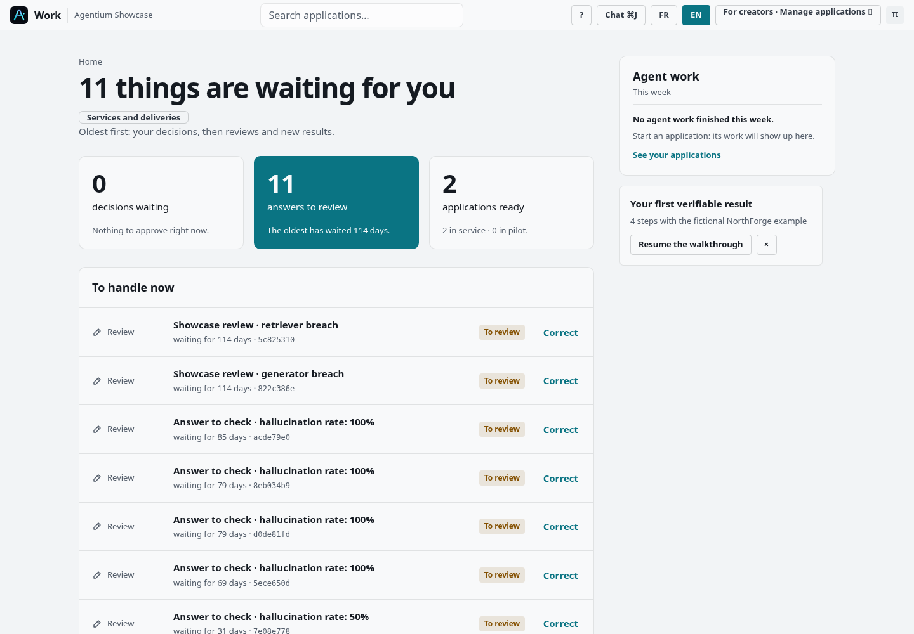
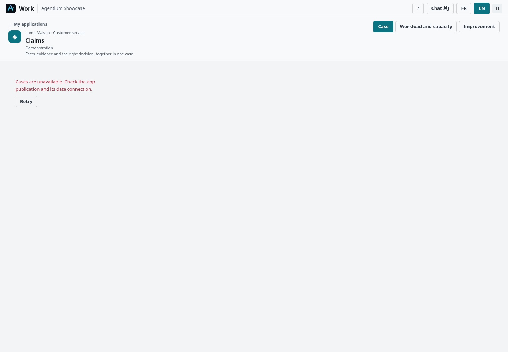
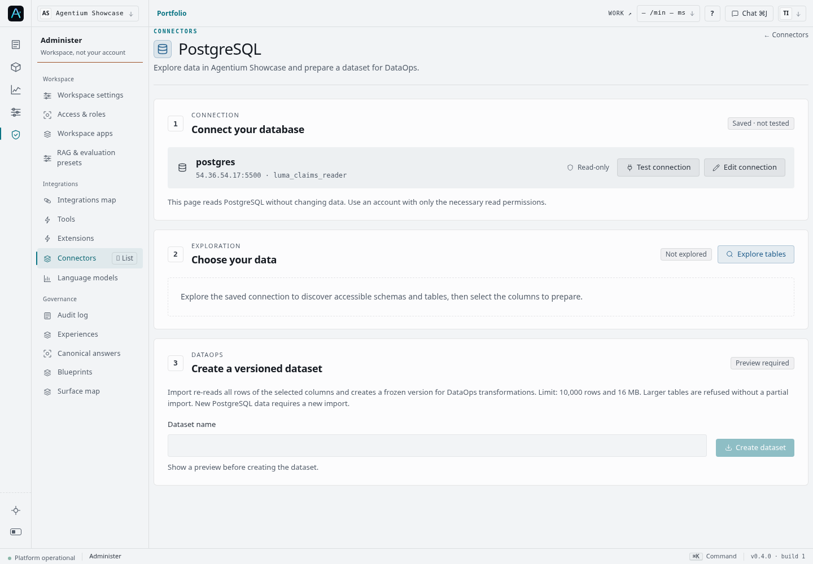
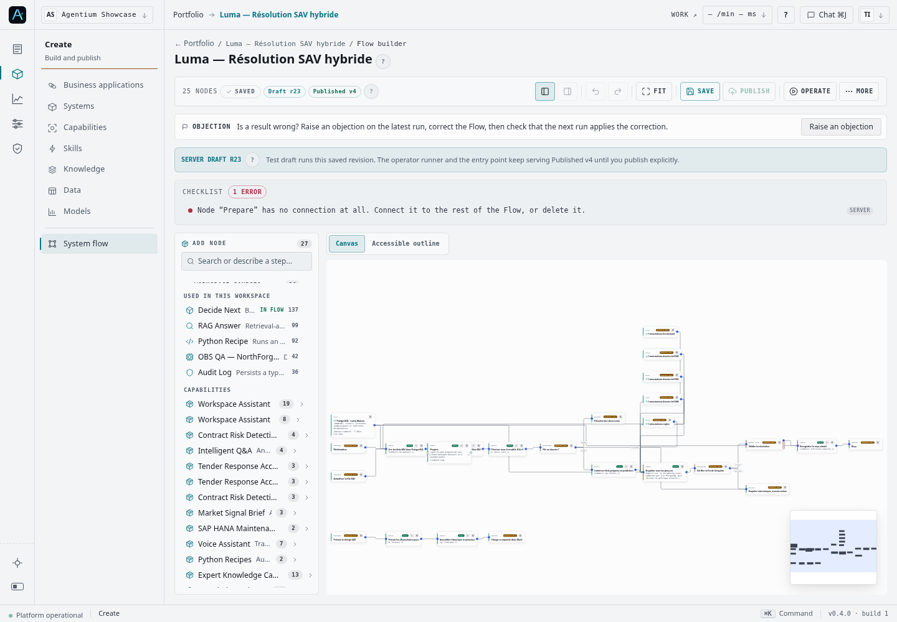
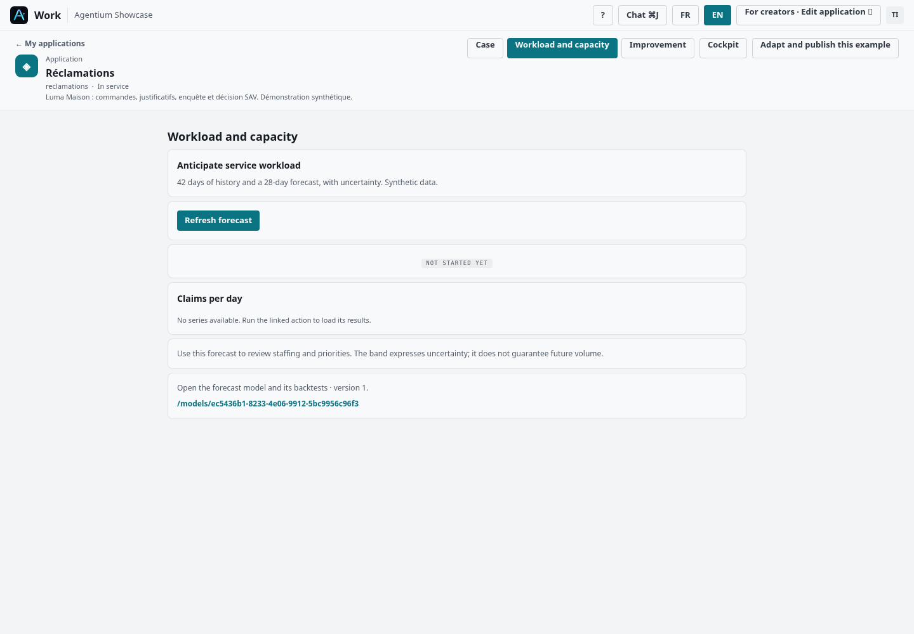
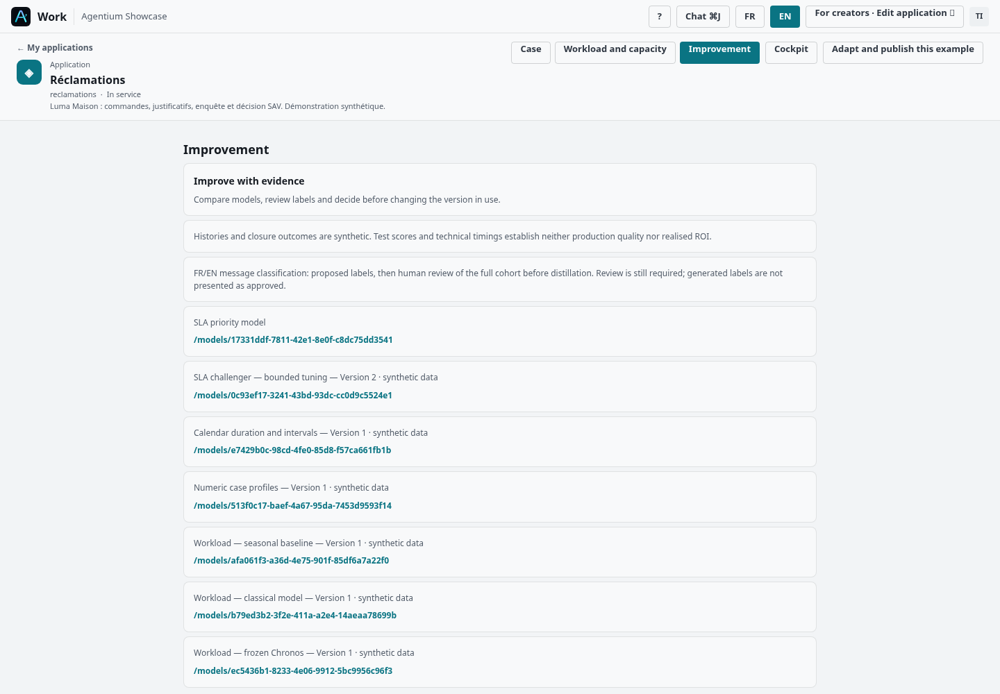
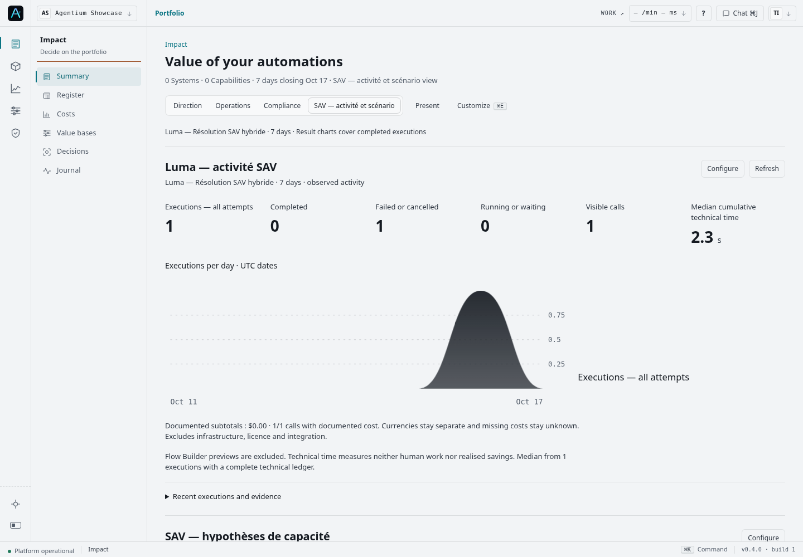
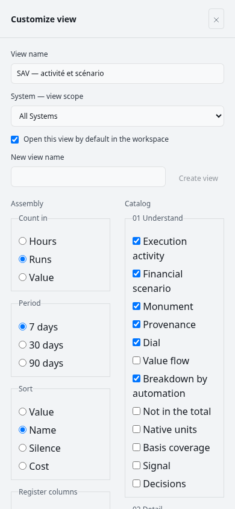
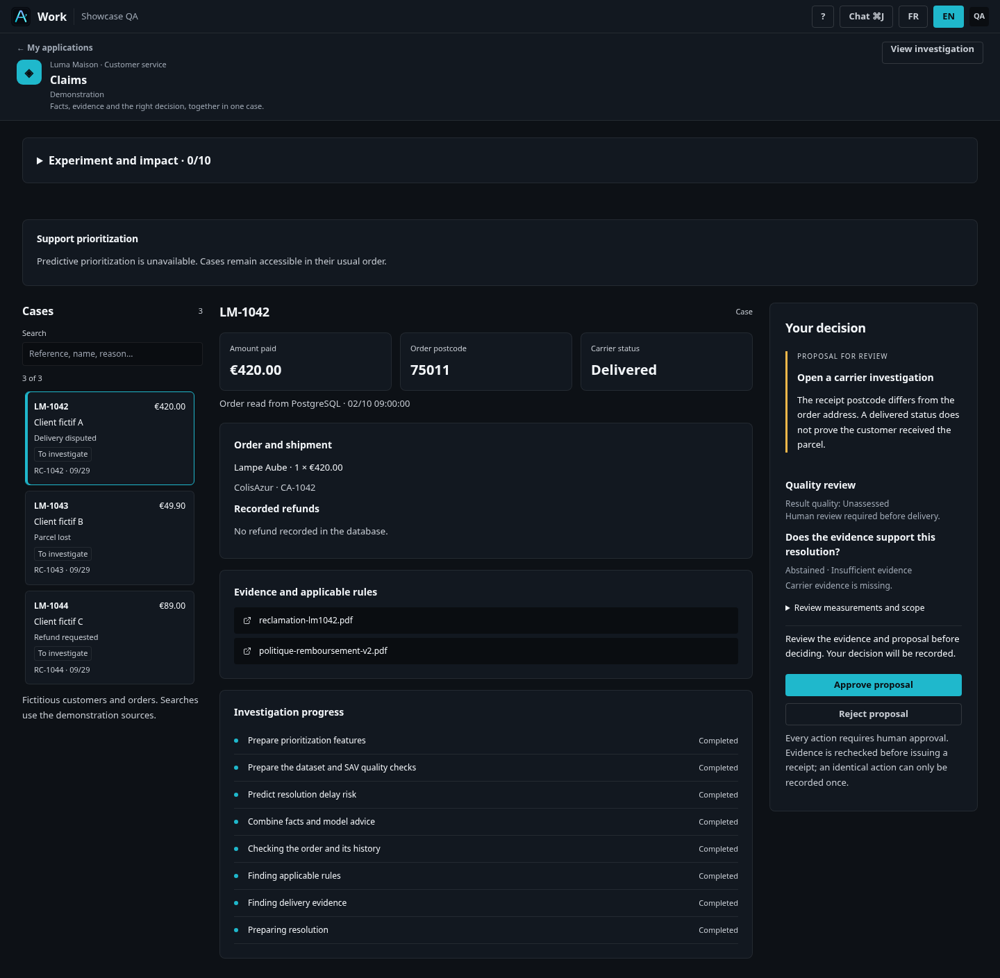
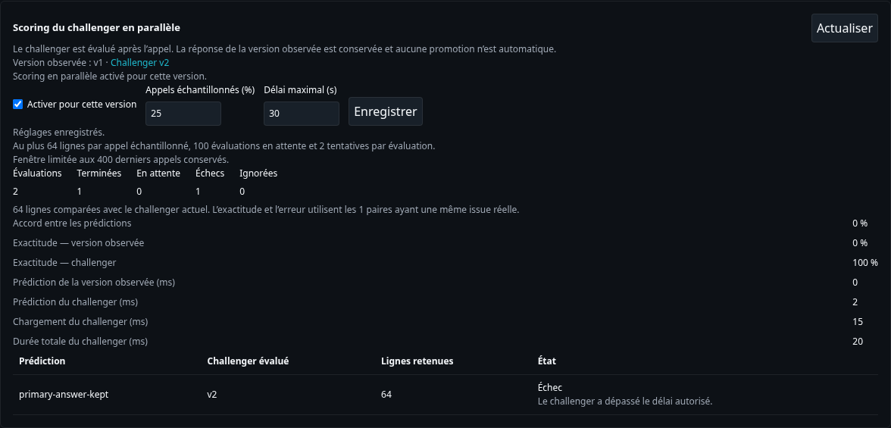

# Audit designer — parcours Luma dans Agentium

**17 octobre 2026 · Agentium Showcase · UI, UX et démonstration du produit**

## 1. Avis de synthèse

**L’identité visuelle est cohérente, les capacités sont riches et les preuves commencent à être bien structurées. L’expérience reste toutefois trop dépendante d’un présentateur expert.** Un utilisateur doit encore comprendre l’organisation technique d’Agentium pour accomplir une tâche SAV, vérifier une décision et retrouver son effet dans Impact.

La principale faiblesse n’est plus la taille du bouton « Open flow ». Elle réside dans la hiérarchie : trop d’informations de même poids, trop de contextes à reconstruire et trop peu de réponses immédiates aux questions « où commencer ? », « puis-je m’y fier ? », « que dois-je faire maintenant ? ».

**En l’état observé, je ne qualifierais pas le parcours de démonstration autonome et prêt à dérouler sans incident.** L’entrée Réclamations échoue sur la lecture des dossiers. Le Flow s’ouvre sur un brouillon complet réduit à une taille peu lisible. Plusieurs écrans exposent un catalogue de moyens plutôt qu’une décision métier. Ces constats n’annulent pas les progrès ; ils indiquent où concentrer le prochain travail.

| Dimension | Appréciation | Ce qui détermine le jugement |
|---|---|---|
| Identité visuelle | Solide | Chrome reconnaissable, palette maîtrisée, surfaces et actions secondaires sobres. |
| Hiérarchie de l’information | Inégale | Bon connecteur guidé ; Flow saturé ; pages Charge et Amélioration fragmentées. |
| Navigation et orientation | Fragile | Passage entre Work, construction, données et modèles sans continuité suffisamment évidente. |
| Lisibilité des décisions | À renforcer | Proposition, avis du Judge, disponibilité réelle et autorisation humaine doivent être mieux distingués. |
| Crédibilité des mesures | En progrès | Activité et scénario financier séparés ; quelques compteurs et graphiques restent trompeurs à première lecture. |
| Autonomie métier | Insuffisante | Dépendance au vocabulaire technique, aux explications orales et à la connaissance des objets. |
| Responsive | Partiel | Des contenus tiennent dans la largeur, mais leur ordre et leur densité restent pensés pour le desktop. |
| Continuité du récit | Prometteuse, non aboutie | Une application et un System peuvent porter le parcours ; leur articulation n’est pas encore évidente à l’écran. |

Ces appréciations sont un jugement de designer fondé sur une inspection heuristique. Ce ne sont ni des notes issues d’un panel utilisateur, ni une certification d’accessibilité.

## 2. Périmètre et fiabilité des observations

Trois niveaux de preuve sont distingués dans ce rapport :

- **OBS** : écran effectivement parcouru le 17 octobre, avec le frontend déployé et les API réelles.
- **QA** : capture locale d’une implémentation récente, avec données simulées pour les tests. Elle permet de juger le rendu, pas de prouver un fonctionnement en production.
- **CODE** : comportement ou structure constatés dans le dépôt ; hypothèse d’usage à confirmer en recette lorsque précisé.

Le dépôt examiné est `demo/agentic`, révision `4a4ea3588fbe52fb40f1da41f1c56ace5161b627`. Les endpoints de build du frontend et du backend déployés annoncent tous deux `f4329db35d428e5f646028c783d7ee335de76e3b` lors du contrôle. **Le code récent et le site observé ne sont donc pas équivalents.**

La navigation utilise Chromium à 1440 × 1000, puis un contrôle ciblé à 390 × 844. Le site complet — assets et API — est relayé sur une origine locale vers `https://agentium.papai.ai`, avec validation TLS côté HTTPS. Les payloads applicatifs ne sont pas modifiés. Ce dispositif permet une inspection du rendu déployé ; il ne valide ni l’accès navigateur HTTPS direct dans cet environnement, ni ses performances ou son comportement d’authentification sur l’origine réelle.

Le compte disponible expose des commandes de créateur. Le rendu observé est principalement en anglais et en thème clair. Les captures locales complémentaires incluent le thème sombre et certains écrans français. Le rôle d’un agent SAV aux droits minimaux et la parité exhaustive des deux langues/thèmes restent à tester.

L’audit n’a lancé aucun remboursement, aucune approbation, aucune publication, aucun entraînement et aucun événement métier. Le panneau de personnalisation Impact a été ouvert sans enregistrer de modification. Le parcours complet d’un dossier jusqu’au reçu n’a pas pu être rejoué en direct, car l’API de liste des réclamations répondait 503. Son analyse visuelle repose donc en partie sur les captures QA identifiées.

L’audit ne couvre pas exhaustivement le clavier, les lecteurs d’écran, les contrastes calculés, les performances, les grands volumes ni tous les scénarios d’erreur. Les tests automatiques déjà passés sont utiles pour la non-régression ; ils ne prouvent pas qu’un utilisateur comprend le produit.

## 3. Les utilisateurs et les questions auxquelles répondre

Le parcours doit servir plusieurs rôles sans leur imposer le même niveau de détail.

| Rôle | Question principale | Détail à révéler à la demande |
|---|---|---|
| Conseiller SAV | Quel dossier traiter et quelle action puis-je autoriser ? | Commande, règles, pièces, explication du score, contrôle qualité. |
| Responsable SAV | Où faut-il intervenir, quelle charge arrive et qu’apporte le dispositif ? | Activité, exceptions, capacité déclarée, hypothèses financières, résultats revus. |
| Créateur de processus / responsable données | Comment les sources et les étapes produisent-elles ce résultat ? | Flow, sources, transformations, versions, configuration des entrées. |
| Spécialiste ML / exploitation | Le modèle et les déclencheurs fonctionnent-ils, et faut-il changer de version ? | Contrat d’entrée, disponibilité, échantillons comparés, labels, coûts, incidents. |

**Principe directeur : une tâche métier en premier, une preuve en second, l’infrastructure en troisième.** Cela ne masque aucune capacité. Cela donne une raison de l’ouvrir.

## 4. Revue du parcours, écran par écran

### 4.1 Arriver dans Work et trouver Réclamations

**OBS · P1.** L’accueil est propre, aéré et reconnaissable. Mais sa priorité visuelle contredit l’intention de la démonstration : « 11 things are waiting for you », des revues techniques anciennes et des mentions de taux d’hallucination occupent le premier écran. La plus ancienne attente est annoncée à 114 jours. Un accompagnement NorthForge apparaît également dans ce workspace.

À 1440 × 1000, le titre de l’application Réclamations se trouve vers 1484 px de hauteur dans la page. Il existe une recherche et un lien vers les applications, mais la tâche métier n’est pas présentée comme l’entrée naturelle.

**Effet :** le visiteur commence par un arriéré technique et une autre histoire. Il peut conclure que le produit n’est pas tenu à jour avant même d’avoir vu sa valeur.

**Recommandation générique :** applications récentes ou épinglées visibles immédiatement ; file d’actions filtrable par application, rôle et statut ; traitement explicite des éléments anciens ; accompagnement contextuel. Ne pas masquer les incidents réels pour embellir la démo, ni créer un accueil réservé à Luma.

**Acceptation proposée :** un utilisateur nouvellement connecté trouve son application en moins de 10 secondes, sans aide et sans faire défiler une longue file de revues étrangères à sa tâche.

### 4.2 Ouvrir un dossier et comprendre l’état du service

**OBS · P0 pour la démonstration.** L’ouverture naturelle de Réclamations mène à la vue dossier, mais les dossiers ne chargent pas. L’écran indique « Cases are unavailable. Check the app publication and its data connection. » et propose Retry. L’appel `/api/v1/ecommerce-claims` répond 503.

Le message évite d’inventer un résultat, ce qui est correct. Il propose cependant deux causes très différentes — publication et connexion — sans dire laquelle est établie, à qui revient l’action ni si l’utilisateur peut continuer ailleurs. La cause profonde de cette réponse 503 n’a pas été déterminée par cet audit.

**Recommandation :** rétablir la dépendance avant toute nouvelle présentation, puis afficher un état générique de disponibilité par fonction : dossiers, priorisation, recherche documentaire, prévision. Donner la dernière tentative, une explication sûre, l’action utile et le rôle responsable. Réessayer doit être une possibilité, pas l’unique réponse à un incident persistant.

La page locale corrigée comporte une organisation pertinente en liste de dossiers, faits/preuves et décision. Mais le bloc d’expérimentation et l’alerte de priorisation occupent beaucoup de place avant le travail. Ces éléments doivent être secondaires pour un conseiller ; l’erreur qui interdit réellement de décider doit rester prioritaire.

Il faut reconnaître les progrès déjà vérifiés localement : file mobile bornée, recherche et sélection clavier, sélection conservée par URL et reçu qui remplace l’invitation à relancer. La recette locale du 16 octobre situe l’action principale vers 645 px avec 23 dossiers, contre environ 5364 px auparavant. Ce gain de découvrabilité est réel dans cette fixture ; l’ordre « décision avant faits critiques » reste néanmoins à affiner.

Un autre décalage est observé en passant de Dossier à Charge ou Amélioration : l’en-tête, le titre et les commandes changent sensiblement, avec davantage de commandes créateur sur les deux dernières pages. Les trois pages doivent conserver la même identité d’application et des onglets stables, tout en adaptant les actions au rôle.

### 4.3 Consulter les documents et vérifier une règle

**OBS + CODE · P1/P2.** Document Center possède les bons objets : collections, sources, indexation, documents, usages et diagnostics. La collection « Luma Maison — Règles SAV en vigueur » expose quatre sources identifiables, dont la politique de remboursement et la procédure d’enquête. C’est un bon support de preuve.

Cependant, l’Overview explique d’abord Qdrant, les chunks, la dimension d’embedding, les modes RAG/CHAH/HAH, la densité et le drift. L’écran Documents arrive après un en-tête technique conséquent. Dans la liste générale, les collections métier côtoient les collections de QA ; cinq petites actions par carte rendent la consultation moins évidente qu’un titre cliquable.

Une ambiguïté supplémentaire apparaît : la fiche Règles annonce **« No system uses this collection yet »**, alors que cette collection est représentée dans le Flow Luma. L’audit ne permet pas de conclure qu’elle est effectivement utilisée à chaque Run : référence déclarée et consommation réelle doivent précisément être distinguées. L’UI actuelle fait porter cette distinction à l’utilisateur.

**Recommandation :** ouvrir par défaut une synthèse de contenu, fraîcheur, disponibilité et usages ; rendre la consultation des documents principale ; ranger les diagnostics dans une facette dédiée. Distinguer « référencée dans le parcours », « liée à un contexte » et « consultée dans une exécution », avec la preuve correspondante.

Deux défauts de comportement ressortent du code : une recherche sans résultat peut afficher le message d’une collection vide, et les filtres immédiats se mêlent à une recherche texte nécessitant Appliquer. Il faut séparer vide / aucun résultat / erreur, puis choisir un modèle d’application des filtres cohérent.

**Acceptation :** depuis une décision, ouvrir en un clic l’extrait exact et sa version, puis revenir au même dossier sans perdre la sélection. Une recherche infructueuse n’incite pas à réimporter les documents existants.

### 4.4 Explorer PostgreSQL

**OBS · point fort, avec une rupture de continuité CODE.** Le parcours « Connexion → Exploration → Dataset DataOps » est l’un des plus lisibles de l’ensemble. Les états « Saved · not tested », « Not explored » et « Preview required » font comprendre qu’une configuration enregistrée ne garantit pas une source utilisable. Les actions sont compactes et correctement subordonnées à chaque étape.

L’import décrit ses limites, son instantané et la nécessité de réimporter pour obtenir de nouvelles données. C’est utile pour éviter de confondre dataset versionné et table vivante. L’exploration réelle des tables n’a pas été relancée pendant cet audit.

**Friction :** le lien de provenance d’un dataset mène à la racine PostgreSQL sans restaurer sa table. L’utilisateur doit refaire la découverte et la sélection. Ce constat vient du code, pas d’un essai d’import.

**Recommandation :** un lien « Ouvrir cette table » portant schéma, table et contexte d’origine ; une confirmation explicite de la fraîcheur ; un retour vers le dataset ou le dossier. Conserver le vocabulaire « connecté », « lecture vérifiée » et « instantané créé » distinct.

### 4.5 Comprendre le dataset et la préparation DataOps

**OBS + CODE · P1 pour l’autonomie.** Le dataset d’apprentissage montre 4573 lignes, neuf colonnes et deux versions. Les facettes aperçu, schéma, lineage et versions structurent bien la consultation. Le lien entre source, transformation, modèle et System est un atout produit.

Pour le récit SAV, les noms de colonnes et la cible brute demandent encore une traduction : quelles données de commande ont été préparées, pourquoi cette transformation, et quelle qualité est nécessaire avant la prédiction ? Un tableau technique seul ne répond pas à ces questions.

La page autonome de préparation conserve son brouillon dans l’état local, sans identifiant de travail dans sa route ni reprise visible dans le code examiné. **Le risque de perte au rechargement reste à reproduire** ; il concerne cette page, pas les nodes déjà persistés du Flow.

**Recommandation :** préparation nommée et reprenable, état de sauvegarde, aperçu avant/après, contrôles utiles au métier et historique des exécutions. Au-dessus du tableau, résumer source/version, transformations et usages. Les actions de retrait ou suppression doivent rester secondaires pendant la consultation.

### 4.6 Comprendre le modèle et sa disponibilité

**OBS · P1 de confiance ; correction partielle QA.** La fiche SLA présente immédiatement « SERVING READY » et AUC 82,1 %. Plus bas, elle indique un ancien artefact sans contrat de lecture qualifié, à réentraîner avant utilisation dans ce runtime. Même si ces états décrivent des dimensions techniques différentes, ils ne sont pas compréhensibles comme tels au premier regard.

L’écran est riche : métriques de test, calibration, seuils, explications et diagnostics. Cette richesse convient à un spécialiste. Pour le responsable SAV, elle n’explique pas assez rapidement ce que le score aide à décider et ce qu’il ne garantit pas. Certaines règles exprimées sur des variables normalisées sont particulièrement difficiles à lire métier.

**Recommandation :** mettre en tête une seule synthèse de disponibilité effective : version sélectionnée, entraînement terminé, appels possibles ou bloqués. Ajouter une explication métier de la qualité, avec période, unité et référence de comparaison lorsqu’elles existent ; conserver les métriques complètes en détail.

Le code récent sépare déjà mieux disponibilité, sélection et entraînement. Les captures locales montrent ce progrès ; sa présence dans le site déployé n’est pas attestée par cet audit. Sur mobile, le chrome, les états, les boutons et les onglets retardent encore l’accès au premier résultat utile.

### 4.7 Lire le parcours hybride dans le Flow

**OBS · P1 majeur.** Le Flow réel montre 25 nodes dans le brouillon r23 et une version publiée v4. La distinction est expliquée, ce qui est bon. Mais l’utilisateur arrive dans l’éditeur : navigation latérale, palette, barre d’actions, bandeau Objection, bandeau de version, checklist et graphe complet.

Le cadrage initial fait tenir l’ensemble du graphe, au prix de nodes minuscules et de libellés illisibles. Une erreur « Prepare » non connecté est affichée dans le brouillon. Elle ne prouve pas que le parcours publié est invalide, mais elle donne immédiatement cette impression à un visiteur.

**L’hybridation existe dans la structure ; elle n’est pas encore lisible sans commentaire oral.** Les collections, PostgreSQL, DataOps, prédiction, agent, validation et reçu sont présents. Le lecteur doit néanmoins découvrir seul l’ordre utile et la différence entre source déclarée et opération réellement exécutée.

**Recommandation générique prioritaire : une vue de lecture du parcours publié**, avec phases métier repliables, entrées/sorties et état de la dernière exécution. « Modifier » ouvre explicitement le Builder. En construction, fermer la palette hors ajout, condenser les bandeaux et cadrer une phase ou la sélection avec ses voisins.

Les liens de données doivent dire « lu par cette étape », « référence déclarée » ou « liaison incomplète ». Un trait graphique ne doit pas suffire à laisser croire qu’une table a été interrogée. L’inspecteur PostgreSQL récent, avec tables, colonnes et aperçu borné, est une bonne base à conserver.

Le plan d’extension à 27 nodes, avec Judge et nouvelles entrées, est préparé dans le dépôt. **Il ne constitue pas le graphe live constaté ici.** Sa lisibilité réelle reste à recetter après activation.

### 4.8 Comprendre le Judge et prendre la décision humaine

**QA + CODE · P1 majeur.** L’intégration locale du contrôle qualité à proximité de la proposition est pertinente. Les questions, abstentions et raisons sont visibles ; confiance et coûts restent en détail. Cela donne au Judge une place utile dans le travail.

La hiérarchie visuelle reste problématique : l’abstention pour preuve transporteur manquante est en texte secondaire, tandis que « Approve proposal » reste l’action cyan la plus saillante. Sur mobile, l’approbation apparaît avant les faits et documents du dossier.

**Le problème n’est pas d’interdire toute approbation après une abstention.** Ouvrir une enquête transporteur peut être exactement la bonne décision quand la preuve manque. L’interface doit rendre explicite ce qui est proposé, ce qui a pu être vérifié, ce qui manque et ce que la personne autorise.

**Recommandation :** résumé « preuve manquante — vérification humaine requise » au même niveau que la proposition ; libellé d’action concret tel que « Autoriser l’ouverture de l’enquête » ; faits critiques et réserves avant confirmation, y compris sur mobile. Chaque citation doit ouvrir l’extrait figé évalué, en conservant la décision visible.

Configurer le Judge demeure une tâche experte : identifiants de rubrique, nodes, chemins JSON, références d’assets et paramètres fournisseur. Un assistant générique « Quoi vérifier ? → Quelles sorties/preuves ? → Quand demander une revue ? → Tester » doit utiliser des sélecteurs alimentés par le Flow. Les réglages techniques restent accessibles en avancé.

### 4.9 Vérifier l’exécution, la décision et le reçu

**QA + CODE ; parcours live bloqué.** La présence de faits, pièces, progression d’enquête et décision dans la même application est la bonne architecture. Les libellés métier des étapes rendent l’agent plus concret qu’une animation de conversation seule.

La continuité doit aller jusqu’au bout : après validation, le même dossier doit présenter l’action autorisée, l’auteur, l’heure, le reçu, l’état simulé ou réel et un lien vers ses preuves. Lorsqu’une répétition est bloquée pour éviter un doublon, le reçu existant doit être retrouvé immédiatement.

**Critère de design à valider :** ouvrir une preuve, revenir au dossier, consulter l’exécution puis Impact ne doit jamais obliger à rechercher à nouveau le cas. Les liens et retours doivent conserver la référence métier, la sélection et le périmètre. Ce comportement n’est pas certifié de bout en bout par l’audit présent.

La conservation du dossier par le paramètre `record`, le retour/rechargement et le reçu avec réexamen explicite sont déjà couverts par la recette locale. Le chantier restant consiste à étendre et vérifier cette continuité sur l’ensemble des surfaces, notamment documents, modèles et Impact, puis sur les données déployées.

### 4.10 Configurer et comprendre les événements

**QA + CODE · P1/P2.** Les nouveaux panneaux cron et webhook sont proportionnés et rattachés à la source sélectionnée. La création en pause, le fuseau, la prochaine échéance et le dernier Run constituent de bons éléments de maîtrise.

Il reste trop d’états à combiner mentalement : On/Off du webhook, activation globale, simulation/réel, circuit de protection. Le cron ne suit pas le mode de simulation événementiel. Une explication textuelle est utile, mais insuffisante comme modèle de commande.

**Recommandation :** un état effectif par déclencheur — En pause, Simulation, Exécution réelle, Bloqué — avec sa cause et son prochain effet. Proposer des horaires usuels, un résumé humain et un sélecteur de fuseau ; réserver cron et JSON libres au niveau avancé. Donner des actions de copie pour endpoint et secret.

L’exploitation a besoin d’un historique proche du déclencheur : reçu, accepté, ignoré, dédoublonné, refusé, puis lien vers le Run. Un statut HTTP ne prouve pas une exécution ; le produit doit rendre ce chemin visible sans obliger à enquêter dans plusieurs écrans.

### 4.11 Piloter la charge

**OBS · P2, avec disponibilité à recetter.** « Charge et capacité » présente six panneaux séparant titre, action, statut, graphique vide, avertissement et lien modèle. L’état observé est « Not started yet ». Aucun recalcul n’a été lancé pendant cet audit.

Cette composition consomme beaucoup d’espace pour une seule tâche. Le lien modèle apparaît sous forme de chemin avec UUID. Surtout, le titre promet une capacité disponible alors que l’écran montre principalement une prévision de volume.

**Recommandation :** un bloc unifié avec objectif, fraîcheur, action compacte, état et série temporelle ; une seule erreur racine si le calcul échoue. Employer un lien « Voir le modèle de prévision ».

Si une capacité humaine est déclarée, la confronter à la prévision avec ses hypothèses, les jours de dépassement et une décision à consigner. Sinon, appeler l’écran « Prévision de charge ». Ne pas convertir implicitement le temps technique du modèle en capacité de traitement humaine.

### 4.12 Améliorer les modèles

**OBS + QA · P1.** La page Amélioration expose des avertissements, puis sept liens vers des modèles. Tous ont presque le même poids. Elle ne fait pas ressortir la version utilisée, le candidat, le signal qui justifie une amélioration et la prochaine décision possible.

C’est une bibliothèque utile à un spécialiste déjà informé. Ce n’est pas encore un parcours de travail pour un responsable SAV. Les termes labels, distillation et challenger apparaissent avant le bénéfice concret.

**Recommandation générique :** une synthèse « version en service / version candidate / couverture des retours / prochaine action », puis trois tâches : revoir les retours, comparer, décider. L’inventaire complet vient ensuite. Entraîner, qualifier et promouvoir doivent rester des décisions distinctes.

Le panneau shadow local distingue correctement accord entre modèles et qualité sur cas labellisés. Mais une exactitude de 100 % peut apparaître avec une seule paire labellisée, le dénominateur étant ailleurs dans le texte. Attacher chaque mesure à son effectif et indiquer quand les données ne permettent pas de conclure. La latence ne doit pas dominer la qualité métier.

### 4.13 Retrouver l’activité et comprendre Impact

**OBS + CODE · progrès important, P1/P2 restants.** Le problème historique d’une grande carte Luma spéciale au-dessus des graphiques n’est plus la bonne description du site constaté. La vue « SAV — activité et scénario » utilise désormais des blocs produit configurables, un périmètre et une période.

Le 17 octobre, la fenêtre de sept jours montre **une tentative, zéro terminée, un échec et un appel visible**, avec 2,3 secondes de durée technique médiane. Les graphiques de résultats terminés restent vides. Les activités du 9 octobre sont hors de cette fenêtre : leur absence sur sept jours ne prouve donc pas une perte de données.

La distinction est juste, mais sa présentation reste confuse :

- l’en-tête annonce « 0 Systems · 0 Capabilities » alors qu’un System est nommé et qu’une tentative est visible ;
- une tentative journalière isolée est rendue comme une bosse lissée, avec une échelle 0,25 / 0,5 / 0,75 ;
- de grands graphiques vides occupent encore l’espace pour la cohorte terminée ;
- période, unité et périmètre se règlent dans Personnaliser, qui mélange exploration et édition d’une vue ;
- dans le code, cliquer un jour produit un résumé sans filtrer réellement la table de preuves ; les lignes de cette table manquent d’heure et de référence métier visibles.

**Recommandation :** séparer explicitement activité de toutes les tentatives et résultats terminés ; afficher les compteurs avec leur population ; utiliser des barres journalières à valeurs entières, distinguant les états ; relier le jour sélectionné aux preuves correspondantes. Remplacer une visualisation vide par un état compact expliquant la cause et l’action utile.

La barre de consultation doit proposer System, période et unité sans exiger l’édition de la vue partagée. Personnaliser reste le lieu d’assemblage et d’enregistrement.

**Le parcours UI générique pour mettre une vue métier en tête est :** Personnaliser → créer ou sélectionner une vue nommée → définir son périmètre et sa période → ajouter les blocs activité/scénario → régler titres, hypothèses et ordre → choisir l’ouverture par défaut du workspace → enregistrer. Le nom « Luma » vient alors de la configuration et des objets sélectionnés, pas d’une règle spéciale dans le composant. L’audit constate cette configuration ; il n’attribue pas sa création historique à une personne sans preuve d’audit.

Sur mobile, le panneau Personnaliser conserve deux colonnes étroites pour assemblage et catalogue. L’absence de débordement horizontal ne suffit pas : les contrôles et intitulés sont comprimés. Une colonne, un catalogue à ouvrir à la demande et les propriétés du seul bloc sélectionné sont préférables.

### 4.14 Lire le scénario financier sans le confondre avec un gain acquis

**OBS + CODE · P2.** Les hypothèses enregistrées sont explicites : huit minutes manuelles, deux minutes assistées, 40 €/h, 0,50 € de budget par dossier. Le bénéfice projeté est 3,50 €/dossier. Le volume mensuel est absent dans la configuration observée ; la projection mensuelle reste donc « — ».

La formule devrait être directement lisible : **(8 − 2) / 60 × 40 − 0,50 = 3,50 € par dossier**. Le ROI de 700 % correspond ici au bénéfice net de 3,50 € divisé par le budget de 0,50 € ; il doit être nommé et expliqué selon cette convention, pour éviter qu’il soit interprété comme un rendement financier global mesuré.

**Recommandation :** faire dominer le gain projeté par dossier et ses hypothèses ; rendre le pourcentage secondaire ; montrer le scénario mensuel seulement si le volume est déclaré. Conserver la distinction entre capacité valorisée, coûts documentés partiels et économies réalisées. Les tentatives techniques, les reprises et les échecs ne sont pas automatiquement des dossiers économisés.

## 5. Critique du langage visuel

### Ce qu’il faut conserver

Le chrome donne une identité stable aux espaces. Les couleurs sont sobres et les actions principales restent reconnaissables. Les boutons récents sont généralement bien dimensionnés ; le lien Open flow est devenu une action secondaire adaptée à la carte. Les séparateurs et nombres tabulaires d’Impact fonctionnent bien. La distinction des versions et les états textuels constituent une base sérieuse de confiance.

### Ce qui doit changer

**La densité doit suivre la tâche.** Le Builder laisse peu de place utile au graphe ; Charge multiplie les panneaux presque vides ; Amélioration donne le même poids à sept liens. Le problème n’est pas un manque uniforme d’espace, mais une mauvaise allocation de cet espace.

**Une bordure ne doit pas devenir le réflexe de composition.** Grouper titre, action, état et résultat d’une même tâche évite l’effet de formulaire empilé. Réserver une nouvelle surface à un changement réel de sujet ou de niveau.

**Les informations importantes doivent rester lisibles.** Des labels à 9–11 px peuvent convenir à un identifiant secondaire, mais pas à une réserve du Judge, une indisponibilité ou une instruction. Garder des actions compactes ne justifie pas de miniaturiser le contenu utile. Les textes gris fins demandent une mesure de contraste, particulièrement en écran partagé.

**L’accent couleur doit porter la décision pertinente.** Une approbation très visible face à une réserve discrète crée une incitation involontaire. Les commandes d’administration — suppression, réentraînement, édition — ne devraient pas concurrencer la consultation dans un parcours métier.

**Les libellés doivent nommer les objets.** Un chemin `/models/<UUID>` n’est pas un intitulé de navigation. Des noms comme « Modèle de prévision », « Règle utilisée », « Extrait évalué » et « Voir cette exécution » avec heure/référence rendent le système intelligible sans supprimer les identifiants de diagnostic.

**Le mobile doit réordonner, pas seulement empiler.** La décision ne doit pas précéder les faits critiques. Les formulaires doivent utiliser la largeur disponible. Un inspecteur Flow doit devenir une vue focalisée, avec retour clair au contexte, plutôt qu’un panneau desktop compressé.

**Les langues et les états doivent être cohérents.** Le parcours observé mélange noms métier français et commandes anglaises. Il faut aussi une grammaire commune pour configuré, vérifié, disponible, sélectionné, publié, exécuté et qualifié. Ces mots ne sont pas interchangeables.

## 6. Priorités produit

P0 désigne un parcours métier impossible à démontrer. P1 désigne une forte rupture de compréhension, d’autonomie ou de confiance. P2 désigne une friction réelle qui ralentit ou dégrade la lecture. Il s’agit de priorités de cet audit, pas de sévérités de sécurité.

| Priorité | Chantier générique | Effet attendu / preuve de réussite |
|---|---|---|
| P0 | Rétablir la lecture des dossiers et recetter les dépendances nécessaires | Un dossier arrive jusqu’à une décision et un reçu, avec états réels vérifiables. |
| P1 | Accueil orienté application et tâches pertinentes | Réclamations trouvable immédiatement ; arriéré et tutoriel étrangers ne dominent plus. |
| P1 | Vue de lecture du parcours publié | Un non-créateur comprend sources, modèle, agent, contrôle et décision sans entrer dans l’éditeur. |
| P1 | États de disponibilité et de consommation cohérents | Aucun « prêt » ou « utilisé » ambigu face à une preuve contraire ; distinction référence/lecture effective. |
| P1 | Revue humaine contextualisée | Proposition, réserve du Judge, pièces critiques et action autorisée sont comprises avant confirmation. |
| P1 | Continuité dossier → preuve → exécution → Impact | Référence, sélection et période conservées ; dernière action retrouvable rapidement. |
| P1 | Impact exploratoire lisible | Compteurs cohérents, filtres accessibles, sélection du jour reliée aux preuves. |
| P1 | Amélioration orientée décision | Version utilisée, candidat, couverture et prochaine action visibles au premier écran. |
| P1 | Configuration sûre des états événementiels | Le prochain effet réel d’un déclencheur est compris sans combiner plusieurs switches. |
| P1 | Vrais états vides ; reprise DataOps à qualifier | Distinguer aucun résultat et absence de données. Reproduire le risque de perte DataOps, puis le traiter en P1 s’il est confirmé. |
| P2 | Simplification Charge et capacité | Un bloc de prévision ; capacité seulement si déclarée ; une décision lisible. |
| P2 | Données quantitatives honnêtes au premier regard | Comptages entiers, dénominateurs visibles, formules financières explicites. |
| P2 | Hiérarchie mobile, typographie, traduction | Premier contenu utile rapidement visible ; actions compréhensibles sans microtexte ni UUID. |

Il n’est pas nécessaire de créer une nouvelle couche spécifique à la démonstration. Ces chantiers concernent les composants de navigation, de preuve, de lecture du Flow, de configuration, de décision et de mesure réutilisables par tous les Systems.

## 7. Ce qui existe, ce qui est préparé, ce qui reste à concevoir

| État | Éléments |
|---|---|
| Observé sur le site | Application Réclamations avec ses trois pages métier ; connecteur PostgreSQL guidé ; collections/documentation ; dataset versionné ; Model Center ; Flow hybride r23 / publié v4 ; vue Impact générique configurée. |
| Observé mais bloquant ou ambigu | Liste des dossiers 503 ; statut modèle contradictoire à première lecture ; graphe réduit ; activité et compteur de Systems divergents ; grandes visualisations sans résultats terminés. |
| Implémenté récemment, preuves locales | File métier, sélection par URL et reçu avec réexamen ; meilleure disponibilité modèle ; contrôle Judge dans Work avec preuves figées ; configuration événementielle contextualisée ; comparaison shadow par échantillon. |
| Préparé, activation non prouvée | Extension Luma à 27 nodes avec Judge et entrées événementielles dans le même System. |
| Recommandations de cet audit | Parcours publié lisible, drill-down conservant le contexte, Amélioration orientée tâches, simplification mobile, état effectif des événements, meilleure lecture d’Impact. |

Le présent rapport n’a pas modifié le produit ni activé ce plan. Il ne transforme pas les captures simulées en preuve de démonstration live.

## 8. Storytelling recommandé

La démonstration doit commencer par la tâche, puis révéler la composition du produit lorsqu’elle explique une décision.

1. **Un client conteste une livraison.** Ouvrir le dossier depuis Work ; exposer le montant, le statut transporteur et le problème à résoudre.
2. **Le système établit les faits.** Montrer la commande PostgreSQL et la fraîcheur de sa lecture, puis une preuve documentaire et la règle applicable.
3. **La préparation et le modèle aident à prioriser.** Expliquer pourquoi ce dossier mérite de l’attention ; ouvrir dataset et version uniquement pour justifier ce point.
4. **L’agent combine ces éléments.** Afficher les étapes et leur résultat utile, pas seulement la liste des outils disponibles.
5. **Le Judge critique la proposition.** Montrer ce qui est soutenu, ce qui manque et quand il s’abstient.
6. **Une personne prend la décision.** Autoriser une action précise et retrouver son reçu sur le même dossier.
7. **Le manager vérifie l’activité et la valeur.** Retrouver la tentative dans Impact ; distinguer ce qui a été observé du scénario financier déclaré.
8. **Le produit s’exploite et s’améliore.** Partir de cette activité pour expliquer charge future, retours validés, comparaison de versions et événements d’entrée.

Le Flow publié sert de carte de ce parcours, dans le même System. Les écrans experts sont des approfondissements contextualisés. Une collection, un modèle ou un webhook n’ont pas besoin d’être montrés simplement parce qu’ils existent : ils doivent répondre à une question dans cette histoire.

## 9. Séquence de travail proposée

**D’abord, rendre une traversée réelle fiable.** Résoudre l’indisponibilité des dossiers, vérifier les modèles appelés, utiliser la version publiée et terminer un cas. Contrôler immédiatement que le reçu et l’activité sont retrouvables. Cette étape précède toute appréciation « prête pour démo ».

**Ensuite, réduire les ruptures de compréhension.** Accueil, lecture du parcours, états cohérents, décision humaine, filtres et preuves dans Impact. Ce sont les améliorations les plus susceptibles de réduire le besoin d’accompagnement oral.

**Puis, rendre la couverture avancée utile et autonome.** Transformer Amélioration en tâche, clarifier l’effet des événements, compléter le pilotage de capacité et la reprise DataOps. Consolider responsive, vocabulaire et micro-interactions sur ces parcours stabilisés.

Une refonte graphique globale avant ces étapes serait un mauvais investissement : elle pourrait rendre les mêmes ambiguïtés plus élégantes sans les résoudre.

## 10. Recette UX à organiser

Une première série de cinq à huit participants représentant les rôles SAV, responsable et créateur permettrait de tester les principaux problèmes. Cette taille est une proposition de recherche qualitative, pas une base statistique pour mesurer un taux de succès global.

| Tâche sans accompagnement | Ce qu’on observe | Objectif proposé, non mesuré |
|---|---|---|
| Trouver son application depuis Work | Premier clic, hésitations, recours à la recherche | Application trouvée en moins de 10 s. |
| Expliquer pourquoi un dossier est prioritaire | Distinction faits / modèle / règle | Explication correcte avec une preuve retrouvée. |
| Vérifier une citation et revenir | Perte de dossier ou de position | Un clic vers l’extrait, retour sans nouvelle recherche. |
| Lire le parcours publié | Confusion entre source, étape, brouillon et production | Identifier les grandes phases en moins de 30 s. |
| Traiter une abstention du Judge | Compréhension de la réserve et de l’action autorisée | Aucune approbation fondée sur une interprétation erronée du contrôle. |
| Retrouver sa tentative dans Impact | Période comprise, distinction échec/terminé | Tentative et preuve retrouvées en moins de 20 s. |
| Expliquer 3,50 € et 700 % | Confusion projection / économie acquise | Formule et hypothèses correctement reformulées. |
| Comparer deux versions avec une seule paire labellisée | Surinterprétation d’un pourcentage | Reconnaissance de l’insuffisance de preuves. |
| Prévoir l’effet d’un webhook et d’un cron | Confusion pause/simulation/réel | Prochain effet réel correctement annoncé avant activation. |
| Reprendre une préparation après rechargement | Perte de travail, capacité à retrouver le résultat | Brouillon et dernier résultat conservés ou perte explicitement prévenue. |

Ajouter des contrôles clavier, focus, lecteur d’écran, contraste, zoom 200 %, petits écrans et volumes représentatifs. Tester notamment une longue liste de dossiers, plusieurs tentatives le même jour, aucune donnée, données périmées, preuve absente et service partiellement indisponible.

## 11. Preuves visuelles

Les captures suivantes sont datées et décrites pour ne pas mélanger site déployé et fixtures. Les identifiants visibles sont ceux des objets de la démonstration ; aucun mot de passe, jeton ou secret de webhook n’est inclus dans ces preuves.

### A. Entrée Work — OBS, site déployé

L’application se trouve sous le premier écran. La file technique et le tutoriel NorthForge prennent la priorité narrative.

### B. Réclamations indisponible — OBS, site déployé

Le parcours métier est bloqué avant le choix d’un dossier. Ce constat est distinct d’un jugement sur la qualité du layout en fonctionnement normal.

### C. PostgreSQL — OBS, site déployé

Une bonne référence interne : progression explicite, états distincts, actions proportionnées.

### D. Flow — OBS, vrai graphe déployé

Le graphe peut contenir le bon parcours sans le rendre immédiatement compréhensible.

### E. Charge et Amélioration — OBS, site déployé

La hiérarchie des tâches doit remplacer l’inventaire de composants.

### F. Impact — OBS, site déployé

Le produit est devenu configurable ; sa consultation et son adaptation mobile restent à simplifier.

### G. Judge et shadow — QA locale, données simulées

Ces captures prouvent un rendu local. Elles ne prouvent ni une qualification statistique ni l’activation du parcours sur le site.

## 12. Sources techniques et documents de référence

Les chemins suivants se lisent depuis la racine du dépôt à la révision auditée. Ils permettent de transformer le diagnostic en tickets génériques sans inférer que tout est déjà déployé.

| Sujet | Source |
|---|---|
| Vues Impact configurables | [Documentation produit](../../impact-configurable-blocks.md) |
| Contrôles et état des nouveautés | [Livraison du 17 octobre](PRODUCT-EXTENSIONS-2026-10-17.md) ; [audit UX du 16 octobre](UX-REVIEW-2026-10-16.md) ; [corrections et recette locale](UX-FIXES-2026-10-16.md) |
| Plan d’extension et limites d’activation | [Runbook d’activation](fixtures/showcase_quality_events/ACTIVATION.md) |
| Navigation vers le Flow | `frontend-ng/src/app/features/systems/systems-grid.component.ts` ; `system-view.component.ts` |
| Sources dans le Flow | `frontend-ng/src/app/features/orchestration/flow/flow-data-source-inspector.component.html` et `.ts` |
| Événements | `frontend-ng/src/app/features/orchestration/flow/flow-triggers-panel.component.ts` |
| Judge et preuve | `frontend-ng/src/app/features/data/typed-judge-editor.component.ts` ; `typed-judge-result.component.ts` ; `frontend-ng/src/app/shared/work-records/run-quality-review.component.ts` |
| PostgreSQL | `frontend-ng/src/app/features/connectors/postgresql/postgresql-connector.component.ts` et `.html` |
| Documents et états vides | `frontend-ng/src/app/features/knowledge/knowledge-view.component.ts` ; `knowledge-base.component.ts` |
| Dataset et reprise de préparation | `frontend-ng/src/app/features/data/data-view.component.ts` ; `data-list.component.ts` ; `data-preparation.component.ts` ; `data.routes.ts` |
| Modèles et comparaison | `frontend-ng/src/app/features/models/model-view.component.ts` ; `shadow-evidence.component.ts` |
| Activité, preuves et projection | `frontend-ng/src/app/features/hypervisor/v2/blocks/impact-activity.html` ; `impact-activity.component.ts` ; `impact-financial-scenario.component.ts` |
| Personnalisation Impact | `frontend-ng/src/app/features/hypervisor/v2/hypervisor-v2.component.ts` |
| Composition Charge et Amélioration | `docs/demo-runs/showcase-ecommerce/fixtures/showcase_learning/workflow_configuration.py` |

**Décision de design recommandée : faire de la continuité d’une tâche vérifiable le critère de réussite.** La démonstration couvrira davantage le produit lorsque l’utilisateur comprendra pourquoi chaque capacité intervient et pourra retrouver son résultat, plutôt que lorsqu’elle affichera davantage de nodes, de modèles ou de cartes.
